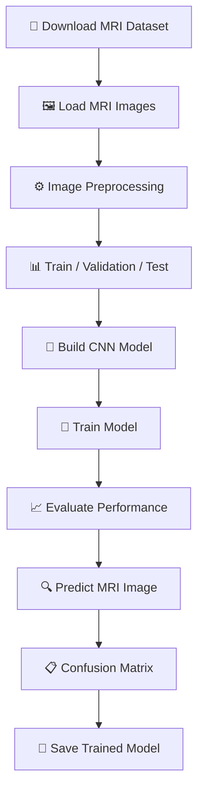

# 🧠 Brain Tumor Detection Using CNN

<p align="center">
  
  
  
  
</p>

## 📌 About the Project

Welcome to the **Brain Tumor Detection Using CNN** project!

This project uses Deep Learning and Convolutional Neural Networks (CNN) to classify brain MRI images into four different categories.

The model learns image features from MRI scans and predicts the corresponding category.

### 🎯 Project Objectives

- Understand image classification using CNN.
- Preprocess brain MRI images.
- Extract image features using convolutional layers.
- Train and evaluate a deep learning model.
- Predict tumor categories from MRI images.
- Visualize model performance using graphs and a confusion matrix.

---

## 📂 Dataset Information

**Dataset:** Brain Tumor MRI Dataset

**Source:** Kaggle

🔗 [Download Dataset](https://www.kaggle.com/datasets/masoudnickparvar/brain-tumor-mri-dataset)

### Four Classification Categories

| Category | Description |
|---|---|
| 🧠 Glioma | MRI images labeled as glioma |
| 🧠 Meningioma | MRI images labeled as meningioma |
| 🧠 Pituitary | MRI images labeled as pituitary tumor |
| ✅ No Tumor | MRI images labeled as no tumor |

---

## 🔄 Project Workflow



---

## 🏗️ CNN Model Architecture

The CNN model consists of convolutional, pooling and fully connected layers.

| Layer | Configuration |
|---|---|
| Rescaling | Normalize pixel values |
| Conv2D | 32 Filters |
| MaxPooling2D | 2 × 2 |
| Conv2D | 64 Filters |
| MaxPooling2D | 2 × 2 |
| Conv2D | 128 Filters |
| MaxPooling2D | 2 × 2 |
| Flatten | Convert feature maps into 1D |
| Dense | 128 Neurons |
| Dropout | 0.5 |
| Output | 4 Classes (Softmax) |

<details>
<summary>🔍 Click to understand CNN layers</summary>

**1. Convolution Layer:** Extracts features such as edges, patterns and shapes from MRI images.

**2. Max Pooling:** Reduces image feature dimensions and computational complexity.

**3. Flatten:** Converts extracted feature maps into a one-dimensional vector.

**4. Dense Layer:** Learns relationships between extracted features.

**5. Dropout:** Helps reduce overfitting by randomly disabling neurons during training.

**6. Softmax:** Calculates probabilities for the four output classes.

</details>

---

## 📊 Model Training

| Parameter | Value |
|---|---|
| Image Size | 150 × 150 |
| Batch Size | 32 |
| Training Split | 80% |
| Validation Split | 20% |
| Epochs | 10 |
| Optimizer | Adam |
| Loss Function | Sparse Categorical Crossentropy |
| Evaluation Metric | Accuracy |

---

## 📈 Model Performance

The model performance is evaluated using the following metrics:

- Training Accuracy
- Validation Accuracy
- Training Loss
- Validation Loss
- Testing Accuracy
- Testing Loss
- Precision
- Recall
- F1-Score

### Training and Validation Graphs

Add your generated accuracy and loss graph here.

```text
images/accuracy_loss.png
```

### Confusion Matrix

Add your confusion matrix image here.

```text
images/confusion_matrix.png
```

---

## 🔍 Model Prediction

The trained model predicts one of the following four classes:

| Class | Prediction |
|---|---|
| Glioma | Glioma |
| Meningioma | Meningioma |
| Pituitary | Pituitary |
| No Tumor | No Tumor |

The prediction output includes:
- Actual image
- Predicted category
- Prediction confidence

---

## 🛠️ Technologies Used

| Technology | Purpose |
|---|---|
| Python | Programming Language |
| TensorFlow | Deep Learning Framework |
| Keras | CNN Model Development |
| NumPy | Numerical Operations |
| Matplotlib | Visualization |
| Seaborn | Confusion Matrix |
| Scikit-learn | Model Evaluation |
| Google Colab | Development Environment |

---

## 📁 Repository Structure

```text
Brain-Tumor-Detection/
│
├── README.md
├── Brain_Tumor_Detection.ipynb
├── accuracy_loss.png
└── confusion_matrix.png
```

---

## 🚀 How to Run the Project

**Step 1:** Clone the repository.

```bash
git clone https://github.com/48Shruti/brain_tumor_cnn
```

**Step 2:** Open the Jupyter Notebook in Google Colab or Jupyter Notebook.

**Step 3:** Execute all notebook cells to train and evaluate the CNN model.

---

## 🎓 Learning Outcomes

After completing this project, you will understand:

- How image classification works.
- How CNN extracts features from images.
- How convolution and pooling layers work.
- How to train a CNN model.
- How to identify overfitting using accuracy and loss curves.
- How to evaluate a classification model.
- How to make predictions on new MRI images.

---

## ⚠️ Disclaimer

This project is developed strictly for educational purposes. It is not a clinically validated medical diagnostic system and must not be used for medical decisions.

---

<p align="center">
  ⭐ If you find this project useful, consider giving it a star!
</p>

<p align="center">
  **Brain Tumor Detection | Deep Learning | CNN | Image Classification**
</p>
